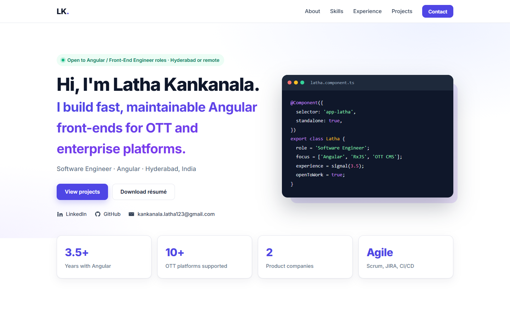

# Latha Kankanala · Portfolio

My personal portfolio site, built with **Angular 22** and pre-rendered to static HTML so it loads fast and search engines can index it.

**Live:** https://latha-kankanala.vercel.app



## Highlights

- Standalone components, Signals and zoneless change detection
- Static pre-rendering (SSG) with hydration, plus Open Graph and JSON-LD `Person` metadata for SEO and link previews
- Reactive Forms contact form with validation that opens the visitor's mail app (no backend needed)
- Responsive layout with a mobile menu
- All content lives in [`src/app/profile.ts`](src/app/profile.ts), so updates don't touch the templates

## Run locally

Requires Node.js 22.22+.

```bash
npm install
npm start        # http://localhost:4200
npm run build    # static site in dist/latha-portfolio/browser
```

## Contact

[LinkedIn](https://www.linkedin.com/in/latha-kankanala) · kankanala.latha123@gmail.com
